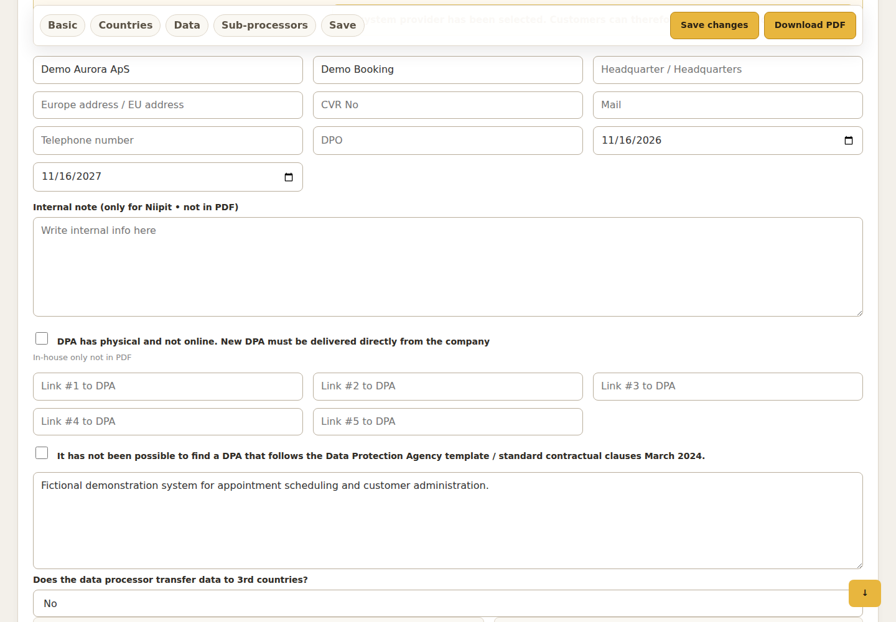
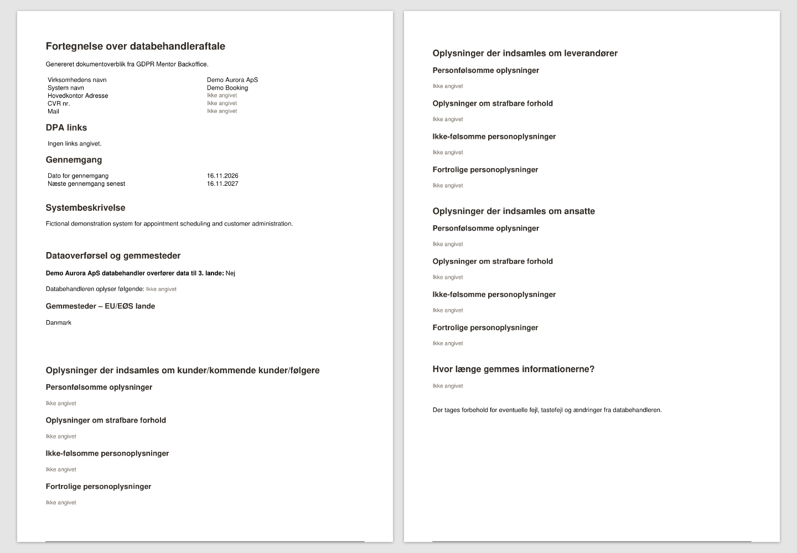

# GDPR & DPA Management — Portfolio Showcase

A PHP and MySQL web application for managing data-processing records, reviewing data processor agreements (DPAs), controlling staff access, and generating structured PDF documents.

This repository presents the application through screenshots captured from an isolated local demo. All company records shown are fictional. Contact details, registration numbers, internal notes and private links were left blank.

**This is a visual portfolio showcase, not an application source release or a hosted demo.**

## Application walkthrough

### 1. Processing records

A central records list brings together search, review dates, PDF access and record-management actions.

[View the full-size records screenshot](screenshots/01-records-list.png)

### 2. DPA form

The form organizes company and system information, review dates, processing countries, data categories and sub-processors. Section navigation and save/PDF controls support the workflow. The screenshot shows the basic fields; sensitive fields are intentionally empty.

[View the full-size form screenshot](screenshots/02-dpa-form.png)

### 3. Role-based administration

Administrators can configure which actions a role may perform and which pages it may access. The example shows viewing, creating and editing enabled, with deletion disabled. Access settings are organized across Backoffice, Clients and Administration workspaces.

[View the full-size permissions screenshot](screenshots/03-user-roles.png)

### 4. Generated PDF

The application's existing PDF generator turns a fictional processing record into a structured document. Both pages are shown side by side. The application screenshots use its English interface; the generated document uses its Danish template.

[View the full-size PDF screenshot](screenshots/04-generated-pdf.png)

## Technology and implementation areas

| Area | Implementation |
| --- | --- |
| Server-side application | PHP |
| Data storage | MySQL / MariaDB |
| Interface | HTML, CSS and JavaScript |
| Document generation | TCPDF |
| Administration | Role-based actions and page-level permissions |
| Record lifecycle | Review dates, updates, disabling and archiving |

## Demo and privacy scope

- Screenshots show the actual application interface, without a redesign or browser chrome.
- Each PNG is 1440 × 1000 pixels and was visually inspected before inclusion.
- The demonstration used a separate local database with fictional records.
- No production data was accessed or modified for the capture.
- Application source, database exports, credentials, environment files, internal documentation, deployment details and original repository history are excluded.

## Repository contents

This repository contains this overview, four demo screenshots and a restrictive ignore file. There is no installation step, live login or production endpoint.

Application source and third-party branding are not offered under an open-source license by this showcase.
