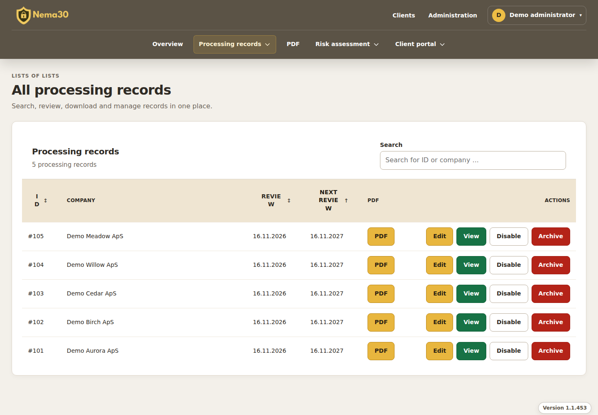
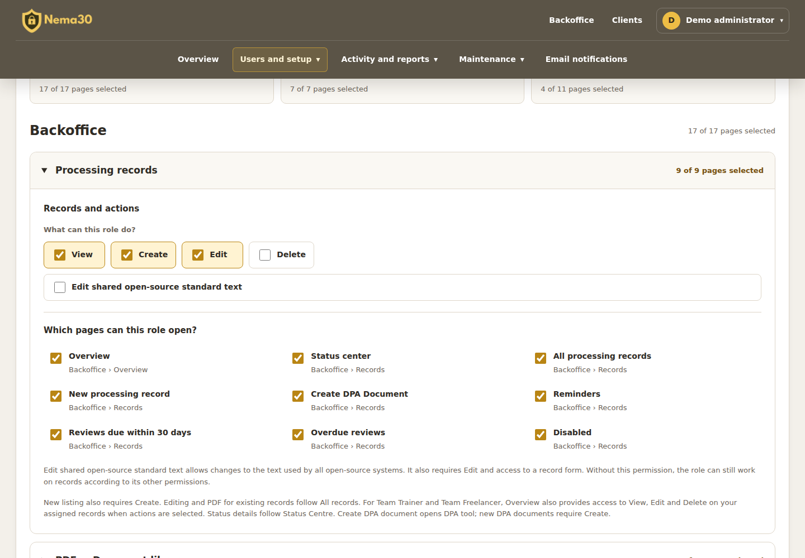

# GDPR & DPA Management — Portfolio & Code Samples

A PHP and MySQL web application for managing data-processing records, reviewing data processor agreements (DPAs), controlling staff access, and generating structured PDF documents.

This repository presents the application through screenshots captured from an isolated local demo. All company records shown are fictional. Contact details, registration numbers, internal notes and private links were left blank.

**This portfolio includes selected, runnable code samples. It is not the full application or a hosted demo.**

## Review the code

These small examples make implementation decisions inspectable without publishing the private application.

| Sample | What it demonstrates | Provenance |
| --- | --- | --- |
| [DocumentFilename.php](samples/DocumentFilename.php) | Date validation, Danish transliteration, duplicate-name handling, bounded filename components | Extracted function; namespace and function name changed |
| [FormOptions.php](samples/FormOptions.php) | Reusable checkbox rendering, escaped labels and attributes, category prefixes and hierarchical options | Extracted functions; translation hook omitted and escaping helper made local |
| [RecordStatus.php](samples/RecordStatus.php) | Prepared statements, atomic record/document changes, audit events and rollback | Standalone adaptation with generic tables, simplified audit data and explicit missing-record handling |
| [tests/run.php](tests/run.php) | Edge cases, HTML escaping, related-record updates and rollback after an injected database failure | New tests using fictional inputs and an in-memory database |

### Run the samples

Requirements: PHP 8.0 or newer with `iconv`, `PDO` and `pdo_sqlite` enabled. No Composer install, database server or credentials are needed.

```sh
php tests/run.php
```

The tests do not load application configuration, connect to production, send email or write a database file. They exit with an error if a check fails or SQLite support is missing.

### Scope of the excerpts

The filename and form examples preserve the extracted logic, with the integration changes listed above. The transaction example preserves the workflow pattern but is deliberately adapted to a tiny, generic schema. Its SQLite tests demonstrate atomicity; they are not a replacement for the application's MySQL integration tests.

These are implementation samples, not a ready-to-deploy service. The transaction caller is responsible for authentication, authorization and CSRF validation, and must not have an existing transaction. Rendering callbacks must come from trusted application code. The complete access-control implementation and proprietary business rules are not included.

## Application walkthrough

### 1. Processing records

A central records list brings together search, review dates, PDF access and record-management actions.



[View the full-size records screenshot](screenshots/01-records-list.png)

### 2. DPA form

The form organizes company and system information, review dates, processing countries, data categories and sub-processors. Section navigation and save/PDF controls support the workflow. The screenshot shows the basic fields; sensitive fields are intentionally empty.


[View the full-size form screenshot](screenshots/02-dpa-form.png)

### 3. Role-based administration

Administrators can configure which actions a role may perform and which pages it may access. The example shows viewing, creating and editing enabled, with deletion disabled. Access settings are organized across Backoffice, Clients and Administration workspaces.



[View the full-size permissions screenshot](screenshots/03-user-roles.png)

### 4. Generated PDF

The application's existing PDF generator turns a fictional processing record into a structured document. Both pages are shown side by side. The application screenshots use its English interface; the generated document uses its Danish template.


[View the full-size PDF screenshot](screenshots/04-generated-pdf.png)

## Technology and implementation areas

| Area | Implementation |
| --- | --- |
| Server-side application | PHP |
| Data storage | MySQL / MariaDB |
| Interface | HTML, CSS and JavaScript |
| Document generation | TCPDF |
| Administration | Role-based actions and page-level permissions |
| Record lifecycle | Review dates, updates, disabling and archiving |

## Demo and privacy scope

- Screenshots show the actual application interface, without a redesign or browser chrome.
- Each PNG is 1440 × 1000 pixels and was visually inspected before inclusion.
- The demonstration used a separate local database with fictional records.
- No production data was accessed or modified for the capture.
- Only the reviewed code samples listed above are published. The complete application, database exports, credentials, environment files, internal documentation, deployment details and original repository history are excluded.

## Repository contents

This repository contains this overview, three PHP samples, a standalone test runner, four demo screenshots and a restrictive ignore file. There is no live login or production endpoint.

Application source and third-party branding are not offered under an open-source license by this showcase.
